# Cartiva

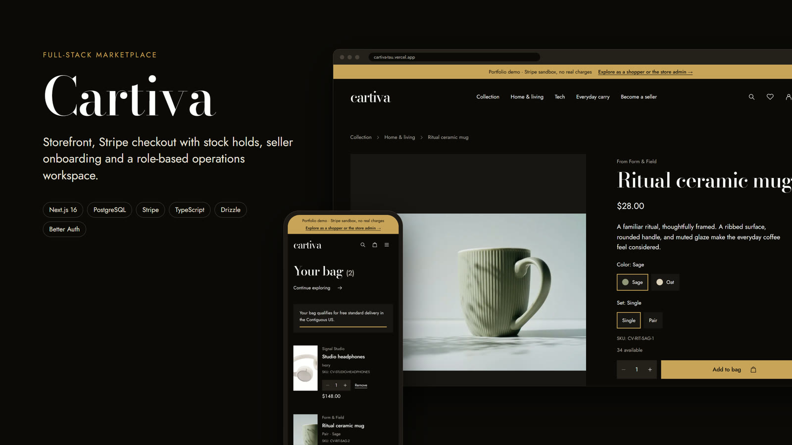

A multi-vendor marketplace for the US market, built with Next.js and PostgreSQL. It covers a storefront with variants and a bag, a real checkout with stock holds and Stripe payments (sandbox), discount codes and shipping zones, customer accounts, seller onboarding, and an operations workspace for staff.

**Live demo:** https://cartiva-tau.vercel.app. Open `/demo` to sign in as a shopper or as the store admin with one click, and pay with the test card `4242 4242 4242 4242`.

Payments run in Stripe's test mode only: the server refuses any key that is not `sk_test_…`, so no real money can move. Products and sellers are sample data.

## Screenshots

| Product page with variants | Review and pay |
| --- | --- |
|  | 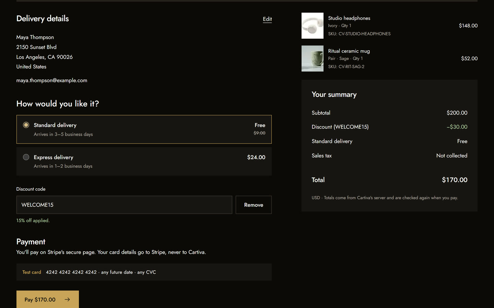 |
| **Payment on Stripe Checkout (sandbox)** | **Order placed after Stripe confirms** |
| 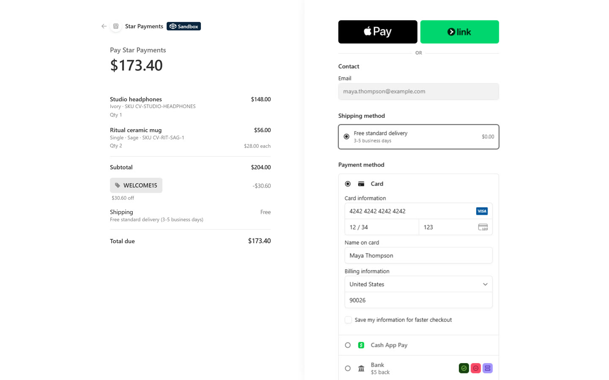 | 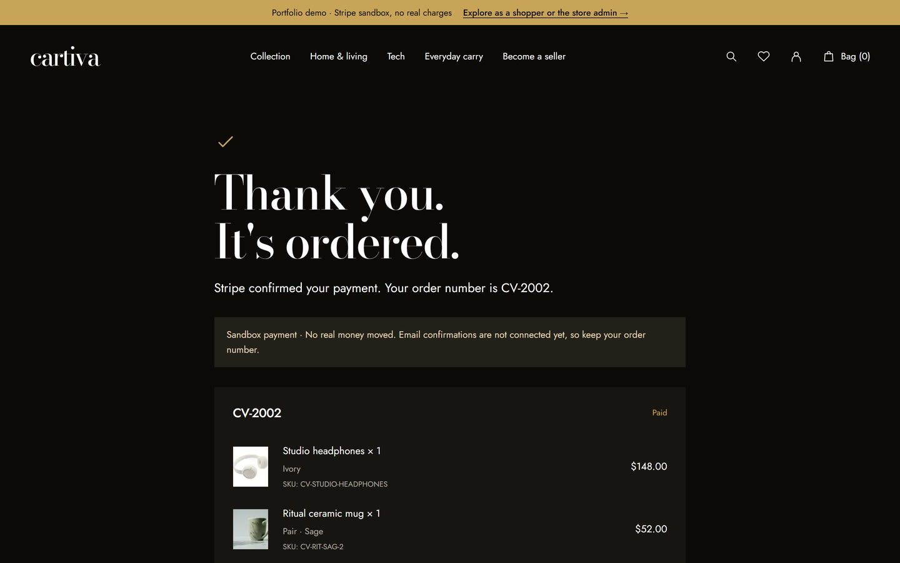 |
| **Orders workspace** | **Order detail: ledger and stock movements** |
| 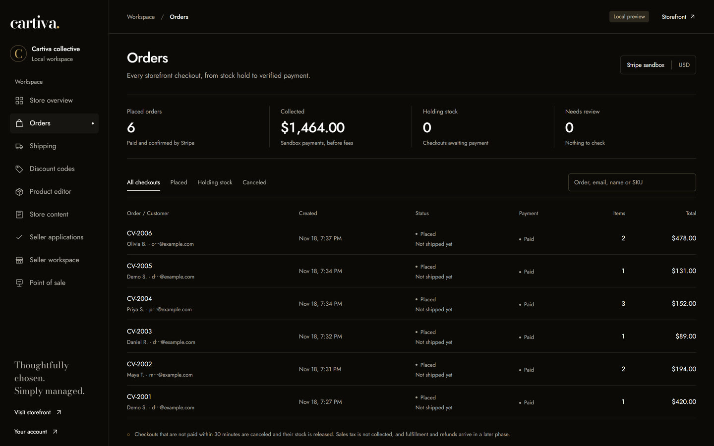 | 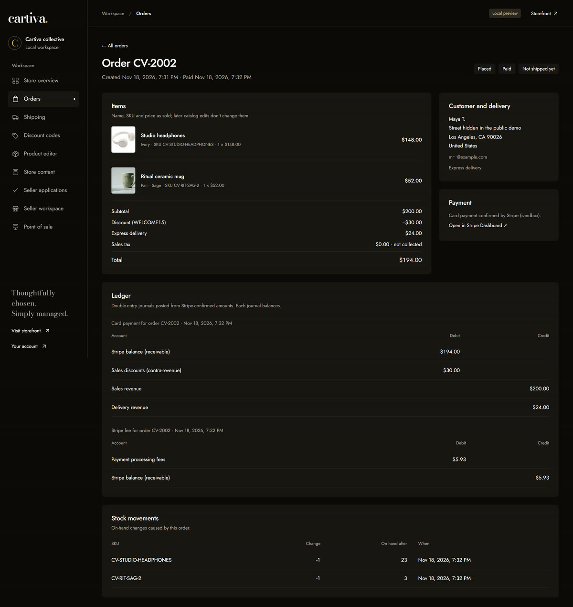 |
| **Product editor** | **Shipping zones and rates** |
| 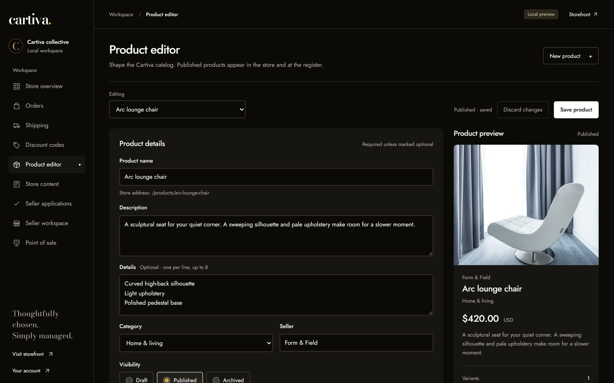 | 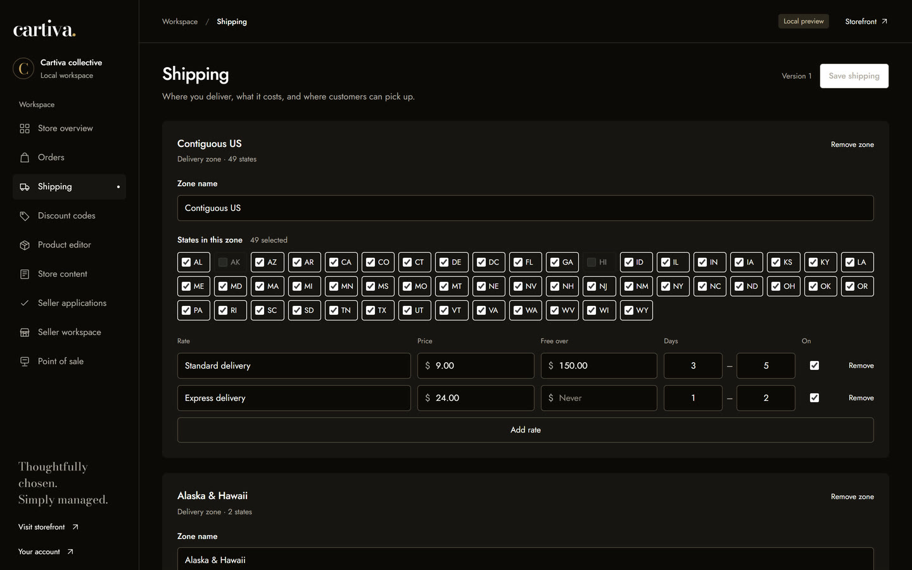 |
| **Discount codes** | **Seller applications** |
| 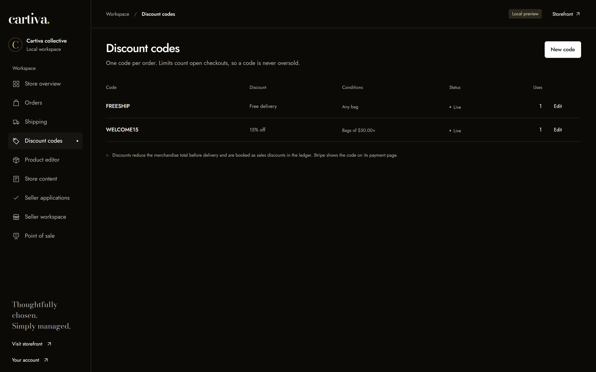 | 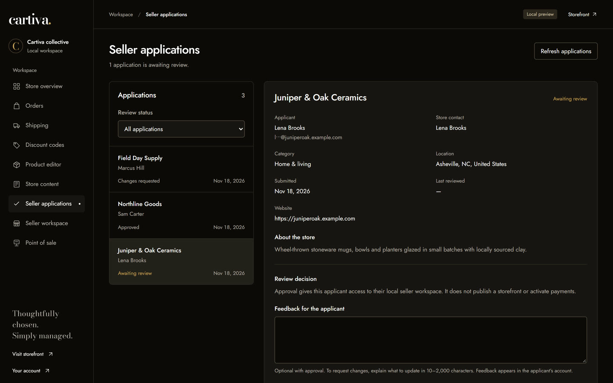 |

**On a phone**

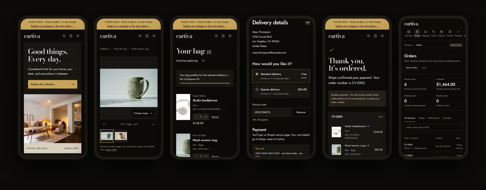

## Features

**Storefront**
- Catalog with categories, search (name, seller, SKU, options), price filter and sorting
- Product pages with independent variants (price, SKU, stock and photos per option combination), a gallery with zoom, and Quick View
- Bag and favorites in the browser, re-checked against live prices and stock
- Free-delivery progress based on the store's shipping settings

**Checkout and payments**
- US delivery details, then delivery options for the shopper's state (standard, express, local pickup) and a discount code, priced by the server
- Stock is held for 30 minutes while the shopper pays on Stripe Checkout; the order is placed only after Stripe confirms the payment
- Repeated clicks or a return from Stripe resume the same order; a changed bag replaces it and releases the earlier hold
- Confirmation page, order history in the account, and guest order lookup by number and email

**Operations workspace** (role-based)
- Orders with payment state, a Stripe Dashboard link, double-entry ledger journals and stock movements
- Product editor: draft/published/archived, up to two option groups and twelve variants, stock adjustments with history, concurrent-edit protection
- Shipping zones by state, rates, free-over amounts, delivery windows and pickup points
- Discount codes: percentage, fixed amount or free delivery, with minimums, dates and use limits
- Seller application review, plus sample dashboards (overview, seller earnings, point of sale, content editor)

## How the money and stock stay consistent

- **Stock holds are atomic.** Checkout locks the variant balances in a fixed order and holds stock with a conditional update (`on hand − reserved ≥ quantity`), so two buyers can never both get the last unit.
- **One pricing path.** The preview and the order use the same server code: database prices → discount code → delivery options for the state → totals. If the total differs from what the shopper saw, the order is refused until they've seen the new one.
- **Discount code limits can't be oversold.** An open checkout holds one use and releases it if it expires.
- **Payments are verified, never trusted from a redirect.** The Stripe webhook is checked against the raw body. Its event id is stored before processing, so replays are ignored. The confirmation page also asks Stripe directly if the webhook is late.
- **Placing an order is one transaction.** It turns the hold into a sale with a stock movement and posts a balanced journal (receivable, sales, sales discounts, delivery, and the Stripe fee when known). It also queues an `order.placed` outbox event.
- **Expired checkouts are closed at Stripe first**, then their holds and code uses are released.

## Tech stack

Next.js 16 (App Router, Cache Components, Turbopack) · React 19 · TypeScript · PostgreSQL 17 · Drizzle ORM · Better Auth · Stripe Checkout · Zod · Tailwind CSS 4 · Node's built-in test runner.

## Project structure

```
src/app          Routes: storefront, account, admin workspace, API route handlers
src/components   UI components
src/lib          Pure logic shared by browser and server (pricing, validation, cart, permissions)
src/server       Database schema and access, auth, orders, payments, settings, demo mode
drizzle/         SQL migrations
scripts/         Setup, migration, seed and local tooling
tests/           Integration suites against an isolated database (Stripe is faked)
docs/            Local setup and deployment guides
```

## Running locally

Requirements: Node 22.18+ and Docker Desktop.

```bash
npm ci
npm run setup:local   # generates .env.local and .env.test.local with random secrets
npm run db:up         # PostgreSQL in Docker on 127.0.0.1:55432
npm run db:migrate
npm run db:seed       # sample catalog and default shipping settings
npm run db:owner      # local owner account; credentials go to .local/owner-access.txt
npm run dev -- --hostname 127.0.0.1 --port 3000
```

To take payments in the Stripe sandbox, add your test keys to `.env.local`:

```
STRIPE_SECRET_KEY=sk_test_...
NEXT_PUBLIC_STRIPE_PUBLISHABLE_KEY=pk_test_...
STRIPE_WEBHOOK_SECRET=whsec_...   # optional locally: from `stripe listen --print-secret`
```

Test cards: `4242 4242 4242 4242` (paid), `4000 0000 0000 9995` (declined), `4000 0025 0000 3155` (3D Secure), with any future date and any CVC.

The production build prerenders the storefront from the catalog, so the database must be running and seeded before `npm run build`. More detail, including the role matrix, is in [docs/LOCAL-ACCOUNTS.md](docs/LOCAL-ACCOUNTS.md).

## Tests

```bash
npm run lint
npm test                        # pure unit tests
npm run test:identity           # integration suites (isolated cartiva_test database)
npm run test:seller
npm run test:catalog
npm run test:orders
npm run test:checkout-settings
npm run test:deploy
```

The integration suites need a one-time test database; see [docs/LOCAL-ACCOUNTS.md](docs/LOCAL-ACCOUNTS.md#integration-tests).

## Deployment

[docs/DEPLOY.md](docs/DEPLOY.md) covers deploying to Vercel with a Neon Postgres database.

With `DEMO_MODE=true`, the site becomes a public demo:
- visitors sign in to shared shopper and admin accounts with one click from `/demo`;
- their contact details are hidden in shared views;
- a daily cron job removes day-old orders and restores the sample store.

## Known limits

- Sales tax is not collected yet. It shows as zero until tax responsibility is set up.
- Email delivery is not connected: order confirmations stay in the outbox table, and accounts are not email-verified.
- No fulfillment, shipping labels, refunds or returns flow yet. Point-of-sale sales don't deduct stock.
- One stock location. Shipping is priced by state, not by weight or ZIP code.

## Credits

Product photography is from Pexels. Sources and photographers are listed in [public/ASSET-SOURCES.md](public/ASSET-SOURCES.md) and on the `/credits` page.
